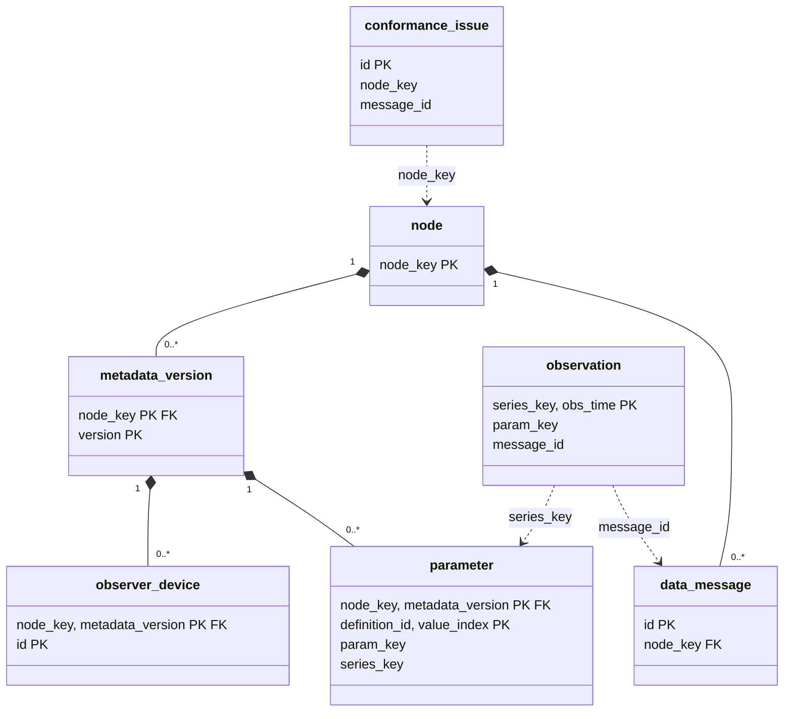

# Database

FMDEhub keeps everything in a PostgreSQL database in the browser (PGlite). The schema is the
numbered migrations in [`packages/db/src/migrations/`](../packages/db/src/migrations/), starting with
[`0001_init.sql`](../packages/db/src/migrations/0001_init.sql), applied in order by `migrate()` in
[`packages/db/src/index.ts`](../packages/db/src/index.ts).

## How the tables connect

Only the key columns are shown; every column is listed under [Tables](#tables).

- **Solid line with a diamond:** an enforced foreign key; deleting the parent deletes the children.
- **Dashed arrow:** a reference the schema doesn't enforce. Retention prunes each table on its own,
  so the row it points to may already be gone.

Three tables stand alone: `monitored_interval` (when the hub was listening), `fmdehub_setting`
and `fmdehub_migration`.

In short: a **node** has **metadata versions**, and each version declares **observer devices** and
**parameters**. A node sends **data messages**; each message yields **observations**, one value per
parameter and time. Problems found in any message are **conformance issues**.

## Tables

`?` marks a nullable column.

### node

One row per node, created by its first message of any kind. Holds a summary of the current metadata.

| Column | Type | |
|---|---|---|
| `node_key` | text | **PK.** `<group>/<node>` |
| `group_id`, `node_id` | text | From the topic |
| `topic` | text | Topic of the first message |
| `declared_id`, `name`, `serial_number`, `firmware_version`, `url` | text? | From the current metadata |
| `location` | jsonb? | From the current metadata |
| `metadata_version` | integer? | Current version; null until metadata arrives |
| `metadata_hash` | text? | Content hash of the current version |
| `metadata_received_at` | timestamptz? | When the current version was first received |
| `metadata_seen_at` | timestamptz? | Last receipt, including identical republishes |
| `metadata_cleared_at` | timestamptz? | Set when retained metadata is deleted (zero-length message) |
| `first_seen_at` | timestamptz | |
| `hub_config` | jsonb | Hub-side settings: `expectedEmpty`, per-node `silentAfterSeconds`, `healthParamMap` (series keys of the battery, solar and logger-temperature parameters) |

### metadata_version

One row per distinct metadata content. An identical republish doesn't add a version. Never pruned.

| Column | Type | |
|---|---|---|
| `node_key` | text | **PK, FK** → `node` |
| `version` | integer | **PK.** 1, 2, 3… |
| `received_at` | timestamptz | |
| `content_hash` | text | SHA-256 of the decoded metadata |
| `message` | jsonb | Decoded metadata as received |
| `normalised` | jsonb | The app's model of it (`MetadataVersion`) |
| `raw_bytes`, `raw` | integer, bytea | Original payload |

### observer_device

One row per observer device in a metadata version.

| Column | Type | |
|---|---|---|
| `node_key`, `metadata_version` | text, integer | **PK, FK** → `metadata_version` |
| `id` | bigint | **PK** |
| `name` | text | |
| `serial_number`, `firmware_version`, `url` | text? | |
| `location` | jsonb? | |

### parameter

One row per value slot of a parameter definition in a metadata version.

| Column | Type | |
|---|---|---|
| `node_key`, `metadata_version` | text, integer | **PK, FK** → `metadata_version` |
| `definition_id`, `value_index` | bigint, integer | **PK.** Position of the value in a data message |
| `param_key` | text | `<node_key>/<definition>/<index>`: changes between versions |
| `series_key` | text | `node\|device\|longName\|cellMethod\|period`: stable across versions |
| `definition_description`, `long_name`, `unit` | text | |
| `standard_names` | jsonb | |
| `device_kind` | text | `node`, `observer` or `unspecified` |
| `observer_id` | bigint? | When `device_kind` is `observer` |
| `cell_method`, `cell_period_seconds` | text, bigint | |

### data_message

One row per data message. Pruned after `retentionDays`.

| Column | Type | |
|---|---|---|
| `id` | text | **PK.** SHA-256 of topic + payload, so redeliveries are stored once |
| `node_key` | text | **FK** → `node` |
| `topic`, `received_at` | text, timestamptz | |
| `first_obs_time`, `last_obs_time` | timestamptz? | |
| `observations`, `values_count`, `empty_values` | integer | Counts |
| `latency_seconds` | float8? | Receipt minus the newest observation time |
| `span_seconds` | float8? | Receipt minus the oldest observation time (backlog) |
| `payload_bytes`, `raw` | integer, bytea | Original payload |
| `metadata_version` | integer? | Version the message was decoded with |
| `conformance` | jsonb | Issues found in this message |

### observation

One row per value, by series and time. If the same series and time arrive twice, the first value is
kept. Pruned after `retentionDays`.

| Column | Type | |
|---|---|---|
| `series_key`, `obs_time` | text, timestamptz | **PK** |
| `node_key`, `param_key` | text | |
| `metadata_version`, `definition_id` | integer, bigint | |
| `value_kind` | text | `floatValue`, `int64Value`, `stringValue`, `emptyValue`… |
| `value_num`, `value_text`, `value_bool` | float8?, text?, boolean? | One is set; `value_text` also holds the exact text of large 64-bit integers |
| `is_empty` | boolean | An `emptyValue` (missing data) |
| `message_id` | text | The `data_message` it came from |
| `received_at` | timestamptz | |

### conformance_issue

One row per issue found in any message, including messages that couldn't be decoded. Pruned after
`retentionDays`, except the issues of each node's current metadata version.

| Column | Type | |
|---|---|---|
| `id` | bigserial | **PK** |
| `received_at`, `topic` | timestamptz, text | |
| `node_key`, `message_id` | text? | Null when the topic isn't a valid node topic |
| `kind` | text | `metadata`, `data` or `unknown` |
| `code`, `severity` | text | e.g. `NODE_NO_NAME`, `error` (see `packages/fmde/src/ats.ts`) |
| `test` | text? | FMDE ATS test, e.g. `/conf/message-encoding/node` |
| `detail` | text | |

### monitored_interval

When the hub was listening. Time outside these intervals is "not monitored", never "missing".

| Column | Type | |
|---|---|---|
| `id` | bigserial | **PK** |
| `source` | text | `mqtt` |
| `from_ts`, `to_ts` | timestamptz | |

### fmdehub_setting

| Column | Type | |
|---|---|---|
| `key` | text | **PK.** `silentAfterSeconds`, `retentionDays`, `futureToleranceSeconds`, `source`, … |
| `value` | jsonb | |

### fmdehub_migration

Created by `migrate()` to record which migrations have run.

| Column | Type | |
|---|---|---|
| `id` | integer | **PK** |
| `name` | text | |
| `applied_at` | timestamptz | |

## Functions

| Function | Does |
|---|---|
| `fmdehub_node_status(from, to, now)` | Each node's state and conformance over a time window; drives the status board |
| `fmdehub_prune(now)` | Retention, run hourly; keeps metadata and the current version's issues |
| `fmdehub_retention_cutoff(now)` | `now` minus `retentionDays` (at least 1 day) |
| `fmdehub_setting_num(key)` | A numeric setting |
